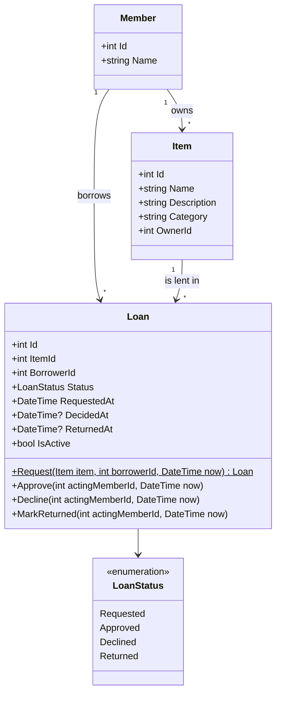
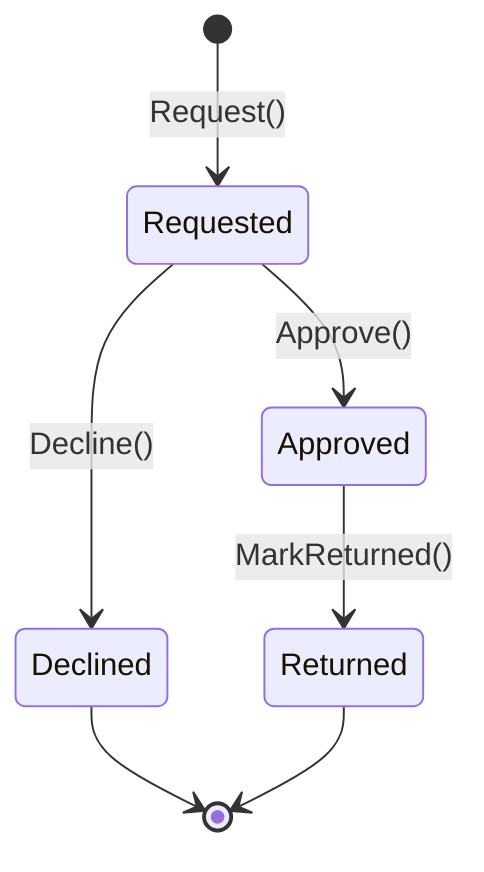

# UML

GitHub renders these diagrams directly on this page.

## Class diagram

## Life cycle of a loan

Rules:

- Only the owner of the item may approve, decline or mark a loan as returned.
- A member cannot borrow their own item.
- While a loan is `Requested` or `Approved` (`IsActive`), nobody else can request the item.
