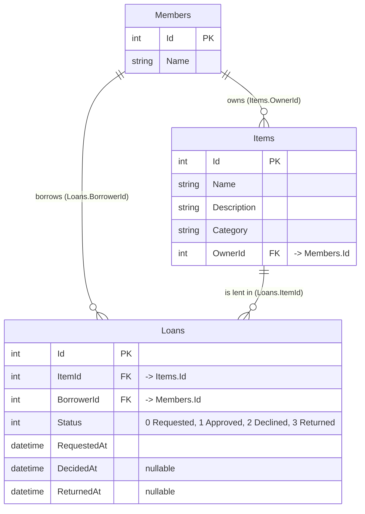
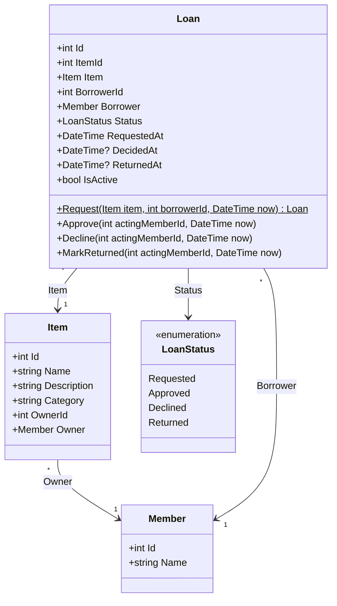
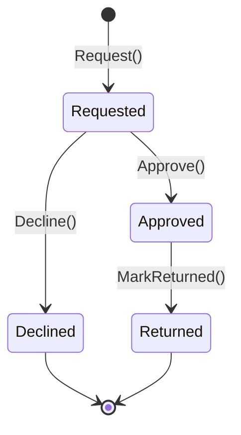

# UML

GitHub renders these diagrams directly on this page.

## Database (ERD)

Three tables. Every arrow is a foreign key (FK) pointing to a primary key (PK).

How to read it:

- One member owns zero or more items. Each item has exactly one owner.
- One member borrows zero or more times. Each loan has exactly one borrower.
- One item can be lent zero or more times over its life. Each loan is about exactly one item.
- A loan is linked to `Members` twice: directly as the **borrower**, and through
  the item as the **owner**.
- `Status` is stored as a number. The API sends it as text ("Requested") only in JSON.
- `IsActive` is not a column. It is calculated in C# from `Status`.

## Class diagram

The arrows show which class holds a reference to which (navigation in the code).

## Life cycle of a loan

Rules:

- Only the owner of the item may approve, decline or mark a loan as returned.
- A member cannot borrow their own item.
- While a loan is `Requested` or `Approved` (`IsActive`), nobody else can request the item.
